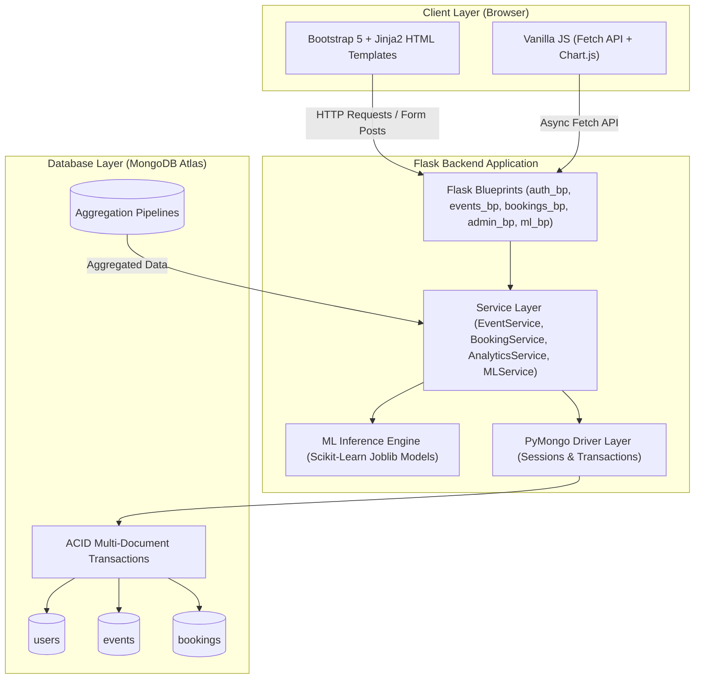
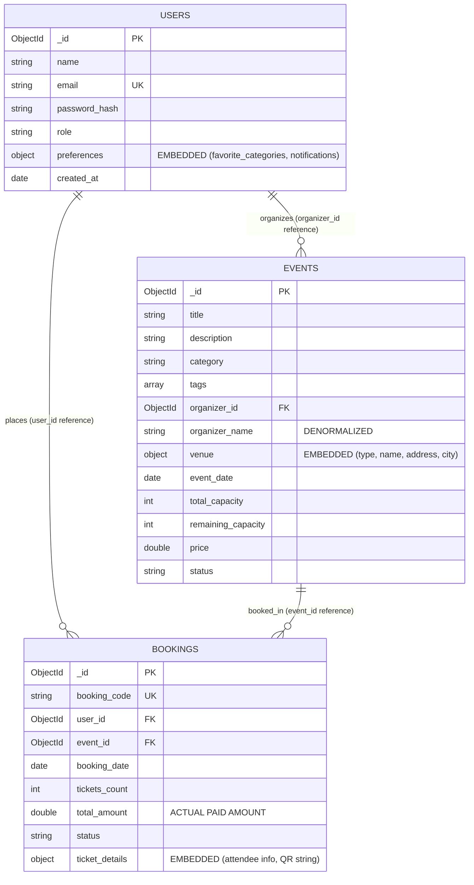
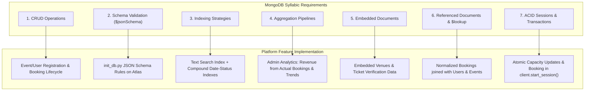
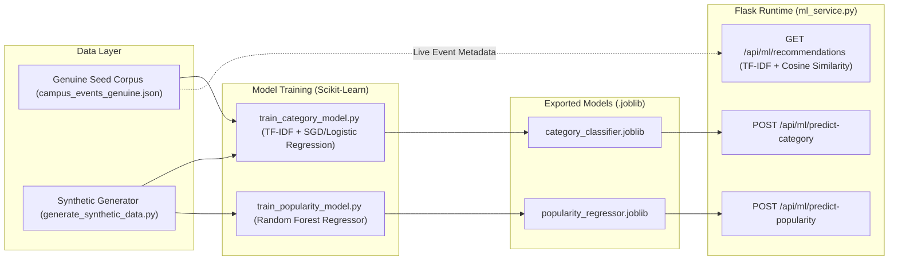
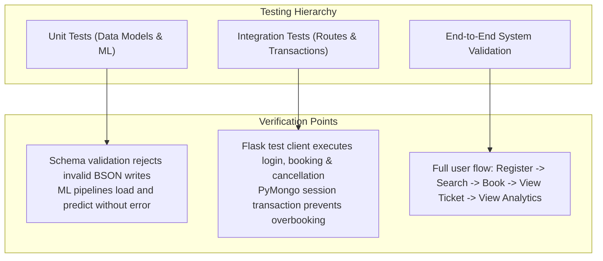
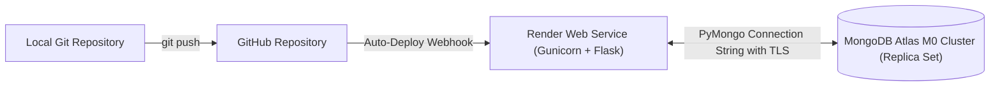

# EventSphere: AI-Powered Event Management Platform
## Complete Project Architecture & Design Specification
**Course:** Intelligent NoSQL Databases (CSE494)  
**Academic Level:** College Continuous Assessment (CA) Project  
**Target Environment:** Local Development & Render Cloud Deployment  
**Document Version:** 1.1.0 (Reviewed & Refined)  

---

## 1. Project Overview

### 1.1 Executive Summary
**EventSphere** is an AI-powered, full-stack event discovery, booking, and administrative management web platform. Designed specifically for university campuses and student organizations, it streamlines how organizers publish events and attendees discover, register for, and manage campus activities.

The platform is powered by **MongoDB Atlas** using the official **PyMongo** native driver without intermediate ORM/ODM layers. It demonstrates core NoSQL database engineering competencies—schema validation, multi-document ACID transactions with sessions, aggregation pipelines, comprehensive indexing strategies, and hybrid document modeling (embedded vs. referenced)—coupled with lightweight Machine Learning models implemented in **Scikit-learn**.

### 1.2 Academic Context & Objectives (CSE494)
As part of the **Intelligent NoSQL Databases (CSE494)** curriculum, EventSphere meets strict academic criteria while maintaining an achievable scope for a college CA project:
1. **Pure NoSQL Data Architecture:** Direct application of PyMongo to showcase raw query execution, native BSON manipulation, schema enforcement via `$jsonSchema`, and MongoDB multi-document ACID transactions.
2. **Intelligent Processing:** Integration of statistical machine learning and Natural Language Processing (NLP) into live application workflows (event recommendations, popularity prediction, and category auto-classification).
3. **Focused Stack:** Built strictly on Python Flask, Bootstrap 5, vanilla JavaScript, and Chart.js. Avoids unnecessary enterprise bloat (no React, no SQL databases, no microservices) to ensure reliability and maintainability on student hardware and Render's free deployment tier.

---

## 2. Functional Requirements

### 2.1 User Management & Access Control
- **User Registration & Authentication:** Secure account creation and login using salted password hashing (Werkzeug / Bcrypt security).
- **Role-Based Access Control (RBAC):** Distinct roles:
  - `User / Attendee`: Browse catalog, search, register tickets, view printable tickets, cancel bookings, set personal category preferences.
  - `Admin / Organizer`: Create, update, publish, or cancel events; view confirmed attendee rosters; monitor platform analytics and aggregation dashboards.
- **Session Management:** Secure Flask session cookies storing user identity, roles, and CSRF protection.

### 2.2 Event Management
- **Event Lifecycle (CRUD):** 
  - Create events with title, description, category, tags, venue (in-person/online/hybrid), date, duration, total capacity, and ticket price.
  - Update event details or update status (`draft`, `published`, `cancelled`, `completed`).
  - Delete or archive past events.
- **Capacity Management:** Dynamic tracking of remaining seats to prevent overselling.

### 2.3 Event Discovery & Search
- **Full-Text Search:** Text-indexed search querying event titles, descriptions, and tag lists.
- **Multi-Faceted Filtering:** Filter by event category, price range (free vs. paid), date (upcoming, today, this weekend), and venue format.
- **Sorting:** Sort catalog by date, title, or popularity.

### 2.4 Transactional Registration & Ticket Generation
- **Transactional Booking Flow:** Users book 1 to 5 seats per transaction.
- **ACID Transaction Execution:** Booking creation and event remaining-capacity decrements run inside a **MongoDB Client Session with multi-document ACID transactions** (`client.start_session()` / `session.start_transaction()`). If remaining capacity is insufficient, the transaction immediately aborts, preventing race conditions and overselling.
- **Ticket Generation:** Issue a unique alphanumeric booking reference code (`EVT-2026-XXXX`), embedded ticket details, and a simulated QR verification string.
- **Transactional Cancellation:** Attendees can cancel reservations prior to the event; a MongoDB transaction updates the booking record to `cancelled` and atomically increments the event's `remaining_capacity` back.

### 2.5 User History & Profile
- Attendee dashboard listing active upcoming tickets, past attendance history, and cancelled reservations.
- Profile preference management to select preferred event categories (which directly feed the recommendation engine).

### 2.6 Admin Dashboard & Analytics
- **KPI Overview Cards:** Total registered users, active events, tickets sold, and cumulative platform revenue calculated strictly from confirmed booking amounts.
- **Visual Analytics:** Interactive Chart.js charts powered by MongoDB aggregation pipelines:
  - Top 5 events by confirmed attendees and actual booking revenue.
  - Event catalog share by category.
  - Monthly ticket sales and revenue trends.

### 2.7 AI & Machine Learning Integration
- **Event Category Auto-Classifier (NLP):** Assisting organizers by predicting the most appropriate event category from title and description.
- **Event Popularity Forecaster (Regression):** Predicting expected attendee turnout and capacity fill rate before publishing.
- **Personalized Recommendations (Content-Based):** Computing cosine similarity scores between user past bookings/interests and upcoming events.

---

## 3. Non-Functional Requirements

| Dimension | Specification | Implementation Strategy |
| :--- | :--- | :--- |
| **Performance & Responsiveness** | Fast, responsive UI with minimal network overhead | Efficient query resolution using MongoDB single-field, compound, and text indexes; ML models serialized via Joblib and loaded into memory on server boot. |
| **Data Integrity & Consistency** | Zero overselling; atomic state transitions; strict schema compliance | MongoDB multi-document ACID transactions (`client.start_session`) for bookings and cancellations; database-level `$jsonSchema` validation on all collections. |
| **Security** | Safe authentication and query handling | Passwords hashed using standard cryptographic algorithms; parameterized PyMongo queries preventing NoSQL injection; role verification decorators on protected routes. |
| **Maintainability** | Clean modular architecture | Flask Application Factory pattern with Blueprints; clear service-layer separation; `.env` configuration management. |
| **Portability** | Multi-environment compatibility | Standard Python 3 packages; cross-platform compatibility across local Windows development and Linux-based Render cloud instances. |

---

## 4. System Architecture

EventSphere follows a **Modular MVC / Layered Monolith Architecture**. It combines server-side rendered HTML (Jinja2) for clean collegiate presentation with asynchronous JSON REST endpoints for ML predictions, dynamic filtering, and Chart.js visualizations.



### Request-Response Flow
1. **User Search / Filter:** Client sends request -> `events_bp` executes indexed MongoDB query -> Returns rendered event catalog cards.
2. **Transactional Booking:** Client triggers booking -> `bookings_bp` starts a PyMongo session transaction -> Checks capacity -> Decrements `remaining_capacity` in `events` and inserts `bookings` document atomically -> Commits transaction -> Generates ticket confirmation.
3. **ML Classification (Interactive):** Organizer types title/description in Event Form -> Background JS triggers `POST /api/ml/predict-category` -> Flask runs pre-loaded TF-IDF + Classifier pipeline -> Suggests category badge dynamically.
4. **Analytics Dashboard:** Admin navigates to `/admin/dashboard` -> `admin_bp` triggers MongoDB Aggregation pipelines -> Delivers structured JSON to Chart.js for visualization.

---

## 5. Technology Stack

| Layer | Technology | Version / Specification | Rationale for Selection |
| :--- | :--- | :--- | :--- |
| **Frontend Markup & Styles** | HTML5, CSS3, Bootstrap | Bootstrap 5.3.x | Rapid responsive UI development, clean presentation without heavyweight JavaScript build chains. |
| **Frontend Scripting** | JavaScript (ES6+) | Native Vanilla JS | Clean DOM manipulation and native `fetch()` calls without framework overhead (No React/Angular/Vue). |
| **Data Visualization** | Chart.js | 4.4.x (via CDN) | Lightweight, responsive canvas-based charting for admin analytics. |
| **Backend Framework** | Python Flask | 3.0.x | Minimalistic, highly readable, ideal for academic demonstrations and straightforward deployment. |
| **WSGI Server** | Gunicorn | 21.x | Production-grade WSGI server for cloud deployment on Render. |
| **Database** | MongoDB Atlas | MongoDB 6.0+ / 7.0+ (M0 Replica Set) | Hosted cloud NoSQL database supporting transactions, aggregations, and native JSON indexing. |
| **MongoDB Driver** | PyMongo | 4.6.x | Official, high-performance Python driver directly exposing native BSON, aggregation pipelines, and session transactions. (No SQL, No SQLAlchemy, No ODM). |
| **Machine Learning** | Scikit-learn, Pandas, NumPy | Python 3.10+ | Standard, reliable machine learning libraries for classification, regression, and vector similarity. |
| **Model Persistence** | Joblib | 1.3.x | Efficient binary serialization and loading of Scikit-learn pipelines and sparse TF-IDF matrices. |
| **Configuration** | python-dotenv | 1.0.x | Secure local and production environment variable management (`.env`). |
| **Deployment Target** | Render | Free Web Service | Frictionless Git-integrated deployment with native Python environment support. |

---

## 6. Proposed Folder Structure

```text
EventSphere/
│
├── .env.example                  # Template for environment variables (MONGO_URI, SECRET_KEY)
├── .gitignore                    # Excludes venv, .env, __pycache__, .joblib files
├── PROJECT_ARCHITECTURE.md       # Complete architectural documentation (this file)
├── Procfile                      # Render WSGI startup command (web: gunicorn run:app)
├── README.md                     # Setup instructions and project run-guide
├── requirements.txt              # Production dependencies
├── run.py                        # Application entry point
│
├── app/                          # Core application package
│   ├── __init__.py               # Flask application factory (create_app)
│   ├── config.py                 # Configuration classes (Dev, Test, Prod)
│   │
│   ├── routes/                   # Flask Blueprints (Controllers)
│   │   ├── __init__.py
│   │   ├── admin_routes.py       # Admin dashboard & analytics views
│   │   ├── auth_routes.py        # Login, registration, logout, profile
│   │   ├── booking_routes.py     # Booking checkout, tickets, cancellations
│   │   ├── event_routes.py       # Event catalog, search, CRUD forms
│   │   └── ml_routes.py          # Asynchronous ML prediction endpoints
│   │
│   ├── services/                 # Business logic & Database interfaces
│   │   ├── __init__.py
│   │   ├── db.py                 # PyMongo client initialization & collection accessors
│   │   ├── event_service.py      # Event queries, text search, CRUD
│   │   ├── booking_service.py    # Transactional booking logic and cancellations with PyMongo sessions
│   │   ├── analytics_service.py  # Aggregation pipeline runners for admin metrics
│   │   └── ml_service.py         # Model loading and inference helper functions
│   │
│   ├── models/                   # MongoDB validation schemas and data helpers
│   │   ├── __init__.py
│   │   └── schemas.py            # MongoDB $jsonSchema definitions for collections
│   │
│   ├── static/                   # Static client assets
│   │   ├── css/
│   │   │   └── style.css         # Custom styling and overrides
│   │   ├── js/
│   │   │   ├── main.js           # Shared utilities (alerts, confirmation dialogs)
│   │   │   ├── search.js         # Debounced event search & filter handling
│   │   │   ├── ml_suggest.js     # Real-time category recommendation AJAX
│   │   │   └── analytics.js      # Chart.js rendering for the admin panel
│   │   └── images/
│   │       └── placeholder.jpg   # Default event thumbnail
│   │
│   └── templates/                # Jinja2 HTML templates
│       ├── base.html             # Master layout with navbar, footer, toast alerts
│       ├── auth/
│       │   ├── login.html        # User & Admin login form
│       │   ├── register.html     # User registration form
│       │   └── profile.html      # Attendee preferences & profile
│       ├── events/
│       │   ├── index.html        # Landing page with featured events & recommendations
│       │   ├── list.html         # Event discovery with filter sidebar & search
│       │   ├── detail.html       # Full event view, organizer info, booking CTA
│       │   └── form.html         # Event create/edit form (Admin/Organizer)
│       ├── bookings/
│       │   ├── my_bookings.html  # User booking history & active tickets
│       │   └── ticket.html       # Printable digital ticket card with simulated QR
│       └── admin/
│           ├── dashboard.html    # KPI overview and Chart.js graphs
│           └── event_manage.html # Tabular event manager with CRUD actions
│
├── ml/                           # Machine Learning pipeline assets
│   ├── datasets/                 # CSV / JSON datasets (clearly separated genuine vs synthetic)
│   │   ├── genuine/              # Curated genuine real-world event corpus
│   │   │   ├── campus_events_genuine.json # Authentic college/academic announcements
│   │   │   └── category_genuine_seed.csv  # Authentic titles and descriptions
│   │   └── synthetic/            # Script-generated training datasets
│   │       ├── popularity_training.csv    # Synthesized regression dataset
│   │       └── category_augmented.csv     # Synthetically balanced category text
│   │
│   ├── saved_models/             # Exported Scikit-learn pipelines (.joblib)
│   │   ├── category_classifier.joblib
│   │   └── popularity_regressor.joblib
│   │
│   ├── train_category_model.py   # Script to train NLP category classifier
│   ├── train_popularity_model.py # Script to train popularity regression model
│   └── generate_synthetic_data.py# Script to generate realistic mock training data
│
└── scripts/                      # Database setup and maintenance utilities
    ├── init_db.py                # Creates collections with $jsonSchema validators
    ├── create_indexes.py         # Sets up single, compound, and text indexes
    └── seed_database.py          # Populates MongoDB Atlas with rich demo records
```

---

## 7. MongoDB Collection Design

To satisfy the academic requirements of **CSE494 (Intelligent NoSQL Databases)**, EventSphere utilizes three primary collections: `users`, `events`, and `bookings`.

### 7.1 Collection: `users`
Stores account credentials, profile details, assigned roles, and embedded preference vectors.

#### Schema Validation Specification (`$jsonSchema`)
```javascript
{
  $jsonSchema: {
    bsonType: "object",
    required: ["name", "email", "password_hash", "role", "created_at"],
    properties: {
      _id: { bsonType: "objectId" },
      name: { 
        bsonType: "string", 
        description: "Full name of the user (required, 2-100 characters)" 
      },
      email: { 
        bsonType: "string", 
        pattern: "^[a-zA-Z0-9_.+-]+@[a-zA-Z0-9-]+\\.[a-zA-Z0-9-.]+$",
        description: "Valid unique email address" 
      },
      password_hash: { 
        bsonType: "string", 
        description: "Bcrypt or Werkzeug hashed password string" 
      },
      role: { 
        enum: ["user", "admin"], 
        description: "Access role: user or admin" 
      },
      preferences: {
        bsonType: "object",
        description: "Embedded user preference document",
        properties: {
          favorite_categories: {
            bsonType: "array",
            items: { bsonType: "string" },
            description: "List of preferred category names"
          },
          receive_notifications: { bsonType: "bool" }
        }
      },
      created_at: { bsonType: "date" },
      updated_at: { bsonType: "date" }
    }
  }
}
```

#### Sample Document Representation
```json
{
  "_id": { "$oid": "654a1001f01a2b3c4d5e0001" },
  "name": "Aarav Sharma",
  "email": "aarav.sharma@college.edu",
  "password_hash": "scrypt:32768:8:1$dGhpcy1pcy1hLXNhbHRA...hashed",
  "role": "user",
  "preferences": {
    "favorite_categories": ["Technology", "Workshop", "Cultural"],
    "receive_notifications": true
  },
  "created_at": { "$date": "2026-09-01T10:00:00.000Z" },
  "updated_at": { "$date": "2026-09-10T14:30:00.000Z" }
}
```

---

### 7.2 Collection: `events`
Stores published and draft events, containing embedded venue information, pricing, capacity counters, and categorization metadata.

#### Schema Validation Specification (`$jsonSchema`)
```javascript
{
  $jsonSchema: {
    bsonType: "object",
    required: ["title", "description", "category", "organizer_id", "event_date", "total_capacity", "remaining_capacity", "price", "status"],
    properties: {
      _id: { bsonType: "objectId" },
      title: { 
        bsonType: "string", 
        minLength: 3, 
        maxLength: 150, 
        description: "Event title" 
      },
      description: { 
        bsonType: "string", 
        minLength: 10, 
        description: "Detailed description used for search & NLP classification" 
      },
      category: { 
        enum: ["Technology", "Cultural", "Sports", "Workshop", "Business", "Academic", "Gaming"],
        description: "Primary category tag" 
      },
      tags: {
        bsonType: "array",
        items: { bsonType: "string" },
        description: "Keyword tags for content-based similarity matching"
      },
      organizer_id: { 
        bsonType: "objectId", 
        description: "Reference to the admin/organizer user document in users collection" 
      },
      organizer_name: { 
        bsonType: "string", 
        description: "Denormalized organizer name for fast retrieval" 
      },
      venue: {
        bsonType: "object",
        required: ["type", "name"],
        description: "Embedded location/venue details",
        properties: {
          type: { enum: ["in-person", "online", "hybrid"] },
          name: { bsonType: "string" },
          address_or_link: { bsonType: "string" },
          city: { bsonType: "string" }
        }
      },
      event_date: { 
        bsonType: "date", 
        description: "Event schedule date and start time" 
      },
      duration_hours: { 
        bsonType: ["double", "int"], 
        minimum: 0.5 
      },
      total_capacity: { 
        bsonType: "int", 
        minimum: 1, 
        description: "Maximum attendees permitted" 
      },
      remaining_capacity: { 
        bsonType: "int", 
        minimum: 0, 
        description: "Remaining seats available" 
      },
      price: { 
        bsonType: ["double", "int"], 
        minimum: 0.0, 
        description: "Ticket price in INR (0.0 represents free entry)" 
      },
      status: { 
        enum: ["draft", "published", "cancelled", "completed"], 
        description: "Current lifecycle state" 
      },
      image_url: { bsonType: "string" },
      created_at: { bsonType: "date" },
      updated_at: { bsonType: "date" }
    }
  }
}
```

#### Sample Document Representation
```json
{
  "_id": { "$oid": "654a2001f01a2b3c4d5e0002" },
  "title": "HackSphere 2026: 24-Hour AI & NoSQL Hackathon",
  "description": "Join the premier annual college hackathon focusing on generative AI and intelligent MongoDB data pipelines. Mentorship, food, and cash prizes included.",
  "category": "Technology",
  "tags": ["AI", "MongoDB", "Hackathon", "Coding", "Flask"],
  "organizer_id": { "$oid": "654a1001f01a2b3c4d5e0099" },
  "organizer_name": "Department of Computer Science",
  "venue": {
    "type": "in-person",
    "name": "APJ Abdul Kalam Auditorium, Block 3",
    "address_or_link": "Campus Main Road, Tech Park Wing",
    "city": "Bengaluru"
  },
  "event_date": { "$date": "2026-11-20T09:00:00.000Z" },
  "duration_hours": 24.0,
  "total_capacity": 200,
  "remaining_capacity": 42,
  "price": 150.0,
  "status": "published",
  "image_url": "/static/images/events/hacksphere.jpg",
  "created_at": { "$date": "2026-10-01T08:00:00.000Z" },
  "updated_at": { "$date": "2026-11-10T12:00:00.000Z" }
}
```

---

### 7.3 Collection: `bookings`
Stores registered tickets, acting as the relational bridge between `users` and `events`. It contains an embedded ticket document with unique verification codes and payment status.

#### Schema Validation Specification (`$jsonSchema`)
```javascript
{
  $jsonSchema: {
    bsonType: "object",
    required: ["booking_code", "user_id", "event_id", "booking_date", "tickets_count", "total_amount", "status", "ticket_details"],
    properties: {
      _id: { bsonType: "objectId" },
      booking_code: { 
        bsonType: "string", 
        description: "Unique human-readable alphanumeric code, e.g., EVT-2026-8942" 
      },
      user_id: { 
        bsonType: "objectId", 
        description: "Reference to attendee _id in users collection" 
      },
      event_id: { 
        bsonType: "objectId", 
        description: "Reference to event _id in events collection" 
      },
      booking_date: { bsonType: "date" },
      tickets_count: { 
        bsonType: "int", 
        minimum: 1, 
        maximum: 5, 
        description: "Number of seats booked in this transaction" 
      },
      total_amount: { 
        bsonType: ["double", "int"], 
        minimum: 0.0,
        description: "Actual total monetary amount paid for this booking (tickets_count * price)"
      },
      status: { 
        enum: ["confirmed", "cancelled", "checked_in"], 
        description: "Reservation status" 
      },
      ticket_details: {
        bsonType: "object",
        required: ["attendee_name", "attendee_email", "qr_payload"],
        description: "Embedded ticket metadata",
        properties: {
          attendee_name: { bsonType: "string" },
          attendee_email: { bsonType: "string" },
          qr_payload: { bsonType: "string" },
          checked_in_at: { bsonType: ["date", "null"] }
        }
      },
      cancelled_at: { bsonType: ["date", "null"] }
    }
  }
}
```

#### Sample Document Representation
```json
{
  "_id": { "$oid": "654a3001f01a2b3c4d5e0003" },
  "booking_code": "EVT-2026-8942",
  "user_id": { "$oid": "654a1001f01a2b3c4d5e0001" },
  "event_id": { "$oid": "654a2001f01a2b3c4d5e0002" },
  "booking_date": { "$date": "2026-11-12T15:45:00.000Z" },
  "tickets_count": 1,
  "total_amount": 150.0,
  "status": "confirmed",
  "ticket_details": {
    "attendee_name": "Aarav Sharma",
    "attendee_email": "aarav.sharma@college.edu",
    "qr_payload": "EVT-2026-8942|654a1001f01a2b3c4d5e0001|654a2001f01a2b3c4d5e0002",
    "checked_in_at": null
  },
  "cancelled_at": null
}
```

---

## 8. Relationships Between Collections



### 8.1 Embedded Document Rationale
1. **User Preferences in `users` (`preferences`):**
   - *Rationale:* User preferences are strictly 1-to-1, small, bounded, and always retrieved when rendering the user profile or building recommendation candidate sets. Embedding avoids secondary collection lookups.
2. **Venue Details in `events` (`venue`):**
   - *Rationale:* An event has exactly one location specification (whether an auditorium or an online link). It is rendered concurrently with event details and never queried in isolation.
3. **Ticket Metadata in `bookings` (`ticket_details`):**
   - *Rationale:* Verification data (attendee name snapshot, QR payload, check-in timestamp) forms an immutable transaction record. Embedding ensures historical accuracy even if the user later updates their account profile.

### 8.2 Referenced Document Rationale
1. **`bookings` referencing `users` and `events`:**
   - *Rationale:* Many-to-Many relationship between attendees and events. 
   - *Anti-Pattern Avoided:* Storing an array of booking IDs or attendee IDs inside `events` would lead to unbounded document growth, risking the MongoDB 16MB document size limit and creating write lock contention during popular ticket rushes.
   - *Implementation:* The `bookings` collection acts as an associative collection using `user_id` and `event_id` references, joined efficiently with native `$lookup` stages during analytics reporting.

---

## 9. MongoDB Concepts & Demonstration Plan

To demonstrate full mastery of **CSE494** syllabus topics, every key MongoDB concept is mapped to a concrete application feature.



### 9.1 CRUD Operations
- **Create:**
  - Insert new user accounts (`db.users.insert_one()`).
  - Publish new events (`db.events.insert_one()`).
  - Create confirmed booking records (`db.bookings.insert_one()`).
- **Read:**
  - Paginated event catalog listing with filter projections (`db.events.find()`).
  - Fast single-document lookups for event details and user tickets (`db.events.find_one()`, `db.bookings.find()`).
  - Full-text search with relevance ranking (`db.events.find({"$text": {"$search": query}})`).
- **Update:**
  - Organizer updates event details (`db.events.update_one({"_id": id}, {"$set": {...}})`).
  - Update user preference tags (`db.users.update_one({"_id": id}, {"$set": {"preferences.favorite_categories": [...]}})`).
- **Delete:**
  - Event cancellation/soft deletion (`db.events.update_one({"_id": id}, {"$set": {"status": "cancelled"}})`).
  - Deletion of unconfirmed draft records (`db.events.delete_one({"_id": id, "status": "draft"}})`).

---

### 9.2 Multi-Document ACID Transactions (PyMongo Sessions)
In a high-concurrency event booking platform, updating remaining capacity and inserting a ticket reservation cannot be performed as disjointed operations; otherwise, network interruptions or race conditions could oversell an event or create orphaned bookings.

Because MongoDB Atlas clusters run as replica sets, multi-document ACID transactions are natively supported. EventSphere demonstrates this via `client.start_session()` in `app/services/booking_service.py`.

#### Booking Transaction Pattern:
```python
def create_booking_transaction(client, user_id, event_id, tickets_count, attendee_info):
    with client.start_session() as session:
        with session.start_transaction():
            db = client.get_default_database()
            
            # Step 1: Verify capacity and atomically decrement within the session
            event = db.events.find_one_and_update(
                {
                    "_id": event_id,
                    "status": "published",
                    "remaining_capacity": {"$gte": tickets_count}
                },
                {"$inc": {"remaining_capacity": -tickets_count}},
                session=session,
                return_document=pymongo.ReturnDocument.AFTER
            )
            
            if not event:
                # Aborts transaction automatically when exception is raised
                raise ValueError("Insufficient seats available or event is not active.")
            
            # Step 2: Compute total amount from actual unit price
            total_amount = float(tickets_count * event["price"])
            booking_code = f"EVT-2026-{uuid.uuid4().hex[:6].upper()}"
            
            booking_doc = {
                "booking_code": booking_code,
                "user_id": user_id,
                "event_id": event_id,
                "booking_date": datetime.utcnow(),
                "tickets_count": tickets_count,
                "total_amount": total_amount,
                "status": "confirmed",
                "ticket_details": {
                    "attendee_name": attendee_info["name"],
                    "attendee_email": attendee_info["email"],
                    "qr_payload": f"{booking_code}|{user_id}|{event_id}",
                    "checked_in_at": None
                },
                "cancelled_at": None
            }
            
            # Step 3: Insert booking document within the same session
            result = db.bookings.insert_one(booking_doc, session=session)
            return booking_code
```

#### Cancellation Transaction Pattern:
```python
def cancel_booking_transaction(client, booking_id, user_id):
    with client.start_session() as session:
        with session.start_transaction():
            db = client.get_default_database()
            
            # Step 1: Mark booking as cancelled within session
            booking = db.bookings.find_one_and_update(
                {"_id": booking_id, "user_id": user_id, "status": "confirmed"},
                {"$set": {"status": "cancelled", "cancelled_at": datetime.utcnow()}},
                session=session
            )
            
            if not booking:
                raise ValueError("Booking not found or already cancelled.")
            
            # Step 2: Restock capacity back to the event
            db.events.update_one(
                {"_id": booking["event_id"]},
                {"$inc": {"remaining_capacity": booking["tickets_count"]}},
                session=session
            )
            return True
```

---

### 9.3 Schema Validation
- Automated on cluster setup via `scripts/init_db.py`.
- Enforces strict BSON data types, required fields, string length bounds, numeric minimums, and strict `enum` constraints for categories, roles, and booking statuses.
- Rejects non-conforming writes at the database engine level, demonstrating true data governance in NoSQL.

---

### 9.4 Indexing Strategy
To optimize read queries and enforce uniqueness, the following indexes are planned:

| Collection | Index Fields | Index Type | Purpose / Query Optimization |
| :--- | :--- | :--- | :--- |
| `users` | `{"email": 1}` | Unique Index | Enforces unique email per user and speeds up login lookups. |
| `events` | `{"title": "text", "description": "text", "tags": "text"}` | Text Index | Powers full-text keyword search across event titles and tags with relevance score sorting. |
| `events` | `{"category": 1, "status": 1, "event_date": 1}` | Compound Index | Optimizes standard catalog queries: filtering published events by category ordered by date. |
| `events` | `{"event_date": 1}` | Single Field | Accelerates date-range queries (upcoming events vs. past events). |
| `bookings` | `{"booking_code": 1}` | Unique Index | Ensures instant ticket validation lookups via reference code. |
| `bookings` | `{"user_id": 1, "booking_date": -1}` | Compound Index | Optimizes retrieval of an attendee's booking history ordered by recency. |
| `bookings` | `{"event_id": 1, "status": 1}` | Compound Index | Accelerates organizer attendee-list lookups and aggregate capacity checks. |

---

### 9.5 Aggregation Pipelines
Four comprehensive aggregation pipelines are implemented in `app/services/analytics_service.py` to power the admin dashboard. **All revenue calculations are computed strictly by summing actual confirmed booking `total_amount` values.**

#### Pipeline 1: Platform Overview KPIs
Computes platform-wide metrics in a single aggregation execution from actual confirmed bookings:
```javascript
db.bookings.aggregate([
  { $match: { status: "confirmed" } },
  {
    $group: {
      _id: null,
      total_bookings: { $sum: 1 },
      total_tickets_sold: { $sum: "$tickets_count" },
      total_revenue: { $sum: "$total_amount" },
      avg_booking_value: { $avg: "$total_amount" }
    }
  }
])
```

#### Pipeline 2: Event Popularity & Actual Booking Revenue Leaderboard (`$lookup` & `$sort`)
Joins `events` with `bookings` to calculate confirmed attendee counts and **actual revenue received from bookings** (not an artificial price multiplication):
```javascript
db.events.aggregate([
  { $match: { status: "published" } },
  {
    $lookup: {
      from: "bookings",
      localField: "_id",
      foreignField: "event_id",
      as: "event_bookings"
    }
  },
  {
    $project: {
      title: 1,
      category: 1,
      total_capacity: 1,
      price: 1,
      confirmed_bookings: {
        $filter: {
          input: "$event_bookings",
          as: "b",
          cond: { $eq: ["$$b.status", "confirmed"] }
        }
      }
    }
  },
  {
    $project: {
      title: 1,
      category: 1,
      attendees_count: { $sum: "$confirmed_bookings.tickets_count" },
      // Accurately sums actual paid amounts from confirmed booking documents:
      total_revenue: { $sum: "$confirmed_bookings.total_amount" },
      occupancy_rate: {
        $cond: [
          { $gt: ["$total_capacity", 0] },
          {
            $multiply: [
              { $divide: [{ $sum: "$confirmed_bookings.tickets_count" }, "$total_capacity"] },
              100
            ]
          },
          0
        ]
      }
    }
  },
  { $sort: { attendees_count: -1 } },
  { $limit: 5 }
])
```

#### Pipeline 3: Category Distribution & Engagement
Groups events by category to compute catalog share and seat allocations:
```javascript
db.events.aggregate([
  {
    $group: {
      _id: "$category",
      event_count: { $sum: 1 },
      avg_price: { $avg: "$price" },
      total_seats_offered: { $sum: "$total_capacity" }
    }
  },
  { $sort: { event_count: -1 } }
])
```

#### Pipeline 4: Monthly Booking & Actual Revenue Trends
Groups confirmed bookings by calendar month for Chart.js line graphs:
```javascript
db.bookings.aggregate([
  { $match: { status: "confirmed" } },
  {
    $group: {
      _id: { $dateToString: { format: "%Y-%m", date: "$booking_date" } },
      monthly_revenue: { $sum: "$total_amount" },
      monthly_tickets: { $sum: "$tickets_count" },
      transaction_count: { $sum: 1 }
    }
  },
  { $sort: { "_id": 1 } }
])
```

---

## 10. AI / Machine Learning Model Architecture

All machine learning components are implemented using **Scikit-learn**, serialized into lightweight `.joblib` files, and loaded into Flask application memory on startup for immediate inference.



---

### 10.1 Component 1: Event Recommendation Engine (Content-Based Filtering)

#### Objective
Recommend upcoming, relevant events to logged-in users based on their declared category preferences and historical event booking tags.

#### Dataset Specification (Genuine vs. Synthetic)
- **Dataset Nature:** Hybrid.
- **Genuine Component:** Real-time event metadata (`title`, `description`, `category`, `tags`) queried directly from active MongoDB `events` documents, initialized from genuine campus event templates (`ml/datasets/genuine/campus_events_genuine.json`).
- **Synthetic Component:** Synthetic user interaction histories generated during seeding to evaluate similarity metrics when real multi-month student traffic is not yet present.

#### Model & Algorithm
- **Algorithm:** **TF-IDF Vectorizer + Cosine Similarity**.
- **Approach:**
  1. Construct a unified text representation for each candidate event:
     $$\text{Content} = \text{title} + " " + \text{category} + " " + \text{tags} + " " + \text{description}$$
  2. Construct a user interest profile from their declared `preferences.favorite_categories` and the tags of their past confirmed bookings.
  3. Transform both user profiles and candidate events into TF-IDF vector space using Scikit-learn's `TfidfVectorizer`.
  4. Compute pairwise cosine similarity scores:
     $$\text{Similarity}(u, e) = \frac{\mathbf{v}_u \cdot \mathbf{v}_e}{\|\mathbf{v}_u\| \|\mathbf{v}_e\|}$$
  5. Rank upcoming events in descending order and return the Top-6 recommendations.

#### Input Features
- User profile: array of preferred category strings, titles and tags of past bookings.
- Candidate events: `title`, `description`, `category`, `tags`.

#### Output
- List of recommended event documents with similarity match score (0.0 to 1.0) and matching keyword reason tags.

#### Evaluation Metrics
- **Top-K Precision (Precision@K) & Recall (Recall@K):** Evaluated against a synthetic user interaction holdout set to verify that recommended events match user interest tags.

---

### 10.2 Component 2: Event Popularity Prediction (Regression)

#### Objective
Predict expected ticket turnout / fill rate percentage for an event prior to publishing, giving organizers guidance on venue sizing and marketing needs.

#### Dataset Specification (Genuine vs. Synthetic)
- **Dataset Nature:** **Synthetically Generated**.
- **Academic Justification:** Clean, multi-variable tabular datasets containing college event lead time, ticket pricing tiers, duration, and final attendance counts are proprietary and not publicly available. Therefore, a deterministic generation script (`ml/generate_synthetic_data.py`) creates `ml/datasets/synthetic/popularity_training.csv` (1,200 samples) incorporating realistic correlations:
  - Free events have higher baseline turnouts.
  - Weekend events exhibit higher attendance.
  - Workshops and tech hackathons show higher attendance persistence despite higher ticket prices.
  - Lead time exhibits an inverted-U shape (too short = low awareness; too long = forgotten).

#### Model & Algorithm
- **Candidate Models:** Linear Regression, Ridge Regression, **Random Forest Regressor** (chosen model).
- **Rationale for Random Forest:** Effectively captures non-linear feature interactions (such as the combined impact of price and duration on student attendance) and avoids overfitting with reasonable tree depth constraints (`max_depth=12`, `n_estimators=100`).

#### Input Features
1. `category`: One-Hot Encoded (Technology, Cultural, Sports, Workshop, Business, Academic, Gaming).
2. `price`: Continuous float (ticket price in INR).
3. `total_capacity`: Integer (total venue capacity).
4. `duration_hours`: Float (length of event).
5. `lead_days`: Integer (days between creation date and event date).
6. `day_of_week`: Integer (0=Monday to 6=Sunday).
7. `is_weekend`: Binary flag (0 or 1).
8. `venue_type`: One-Hot Encoded (in-person, online, hybrid).

#### Output
- Predicted attendee count ($\hat{y} \in [0, \text{total\_capacity}]$) and capacity fill rate percentage ($\frac{\hat{y}}{\text{total\_capacity}} \times 100\%$).

#### Evaluation Metrics
- **Mean Absolute Error (MAE):** Average difference between predicted and actual attendee count.
- **Root Mean Squared Error (RMSE):** Penalizes large prediction errors.
- **Coefficient of Determination ($R^2$ Score):** Target benchmark $> 0.70$ on the test split.

---

### 10.3 Component 3: Event Category Auto-Classifier (NLP Classification)

#### Objective
Automatically infer and suggest the most appropriate category (e.g., "Technology", "Cultural", "Sports", "Workshop", "Business", "Academic", "Gaming") when an organizer enters an event title and description.

#### Dataset Specification (Genuine vs. Synthetic)
- **Dataset Nature:** **Curated Genuine Corpus + Synthetic Data Augmentation**.
- **Genuine Core:** 250+ curated college event titles, hackathon announcements, and cultural fest blurbs sourced from authentic campus notices (`ml/datasets/genuine/category_genuine_seed.csv`).
- **Synthetic Augmentation:** 600+ synthetic event descriptions generated via template expansion (`ml/datasets/synthetic/category_augmented.csv`) to balance class representation across all 7 categories and prevent data sparsity.

#### Model & Algorithm
- **Preprocessing:** Text lowercasing, punctuation removal, stop-word filtering, and TF-IDF vectorization with unigram and bigram extraction (`max_features=2500`).
- **Model:** **SGDClassifier (Linear SVM with log-loss / Logistic Regression)**.
- **Rationale:** Linear models with TF-IDF representations are computationally lightweight with minimal memory footprints, making them ideal for synchronous request cycles without requiring dedicated GPU hardware. They also output calibrated class probabilities (`predict_proba`) for confidence badges.

#### Input Features
- Combined raw text: `title + " " + description`.

#### Output
- Predicted Category label (e.g., `"Technology"`) and confidence probability (e.g., `88.5%`).

#### Evaluation Metrics
- **Classification Accuracy:** Overall accuracy on test split.
- **Macro-Averaged F1-Score:** Balances precision and recall evenly across all 7 classes.
- **Confusion Matrix:** Evaluated during training to ensure minimal false cross-classifications.

---

### 10.4 Dataset Provenance & Synthesis Summary

| Dataset File | Nature | Source / Generator | Record Count | Used By Component |
| :--- | :--- | :--- | :--- | :--- |
| `campus_events_genuine.json` | **Genuine** | Curated real campus announcements & hackathons | 30 seed events | Component 1 & DB Seeder |
| `category_genuine_seed.csv` | **Genuine** | Curated academic event notices & cultural briefs | 250 records | Component 3 |
| `category_augmented.csv` | **Synthetic** | `generate_synthetic_data.py` (template expansion) | 600 records | Component 3 |
| `popularity_training.csv` | **Synthetic** | `generate_synthetic_data.py` (statistical distributions) | 1,200 records | Component 2 |

---

## 11. Frontend Page Plan

The frontend employs standard **Bootstrap 5.3**, semantic HTML5, and vanilla JavaScript for a responsive, modern aesthetic.

### 11.1 Master Layout & Reusable Partials
- `base.html`: Common HTML structure, responsive navbar (with dynamic links for guest, user, and admin), flash message toast containers, and footer.
- `_alerts.html`: Renders dismissible Bootstrap alert components for success, error, and warning flashes.

### 11.2 Page Breakdown

```text
┌────────────────────────────────────────────────────────────────────────┐
│ NAVBAR: EventSphere Logo | Discover | Recommendations | My Bookings   │
│         [Admin Panel (if admin)]                     [User: Aarav ▼]  │
├────────────────────────────────────────────────────────────────────────┤
│ HERO SECTION: Find Amazing Campus Events                              │
│ [ Search events by title, keyword, or tag... ] [Filter Category ▼]    │
├────────────────────────────────────────────────────────────────────────┤
│ AI RECOMMENDED FOR YOU (Dynamic Content-Based Suggestions)             │
│ [Card: HackSphere]       [Card: AI BootCamp]    [Card: Music Fest]     │
│ Match: 95%               Match: 88%             Match: 82%             │
├────────────────────────────────────────────────────────────────────────┤
│ ALL UPCOMING EVENTS (Filterable Grid)                                 │
│ [Event Card 1]           [Event Card 2]         [Event Card 3]         │
│ Date: Nov 20             Date: Nov 22           Date: Nov 25           │
│ Seats Left: 42           Seats Left: 15         SOLD OUT               │
└────────────────────────────────────────────────────────────────────────┘
```

1. **Home / Landing Page (`templates/events/index.html`):**
   - Hero banner with quick search bar and category icon pills.
   - "Recommended For You" carousel/grid (loaded for logged-in users via Content-Based Filtering).
   - "Trending / Popular Events" section highlighting high-turnout events.
2. **Event Discovery & Catalog (`templates/events/list.html`):**
   - Left sidebar filter: Categories (checkboxes), Price (Free/Paid toggle), Venue type, Date picker.
   - Right main area: Responsive grid of event cards with image, category badge, date, pricing, remaining seat counter, and "View Details" button.
   - Asynchronous search input updating results without full-page reloads.
3. **Event Detail View (`templates/events/detail.html`):**
   - High-resolution event header, organizer identity, venue details, and full description.
   - Capacity progress bar showing fill status (e.g., "158 / 200 Seats Booked").
   - Machine Learning badge: "Predicted Popularity: High (Expected 85%+ Turnout)".
   - Primary action: "Book Ticket" modal launcher (or "Event Full" / "Cancelled" disabled state).
4. **Event Creation / Edit Form (`templates/events/form.html`) [Admin/Organizer Only]:**
   - Input fields: Title, description, date, duration, total capacity, price, venue details.
   - **Interactive ML Feature:** Dynamic category auto-suggest badge appears as the organizer types the title/description (via `POST /api/ml/predict-category`).
   - Popularity preview button: Calculates and displays expected attendance count using the regression model before publishing.
5. **Attendee Booking History & Digital Ticket (`templates/bookings/my_bookings.html` & `ticket.html`):**
   - Tabular view of upcoming vs. completed vs. cancelled bookings.
   - Ticket modal/view: Styled printable boarding-pass style card showing booking reference code (`EVT-2026-XXXX`), attendee name, event timing, venue, and simulated SVG/Canvas QR verification code.
   - One-click "Cancel Registration" button with confirmation alert.
6. **Admin Dashboard & Analytics (`templates/admin/dashboard.html`):**
   - 4 Top Metric KPI Cards: Total Users, Total Active Events, Tickets Sold, Cumulative Revenue.
   - Chart.js Visualizations:
     - *Bar Chart:* Top 5 Events by Confirmed Attendees & Actual Revenue.
     - *Doughnut Chart:* Event Category Distribution.
     - *Line Chart:* Monthly Booking & Actual Revenue Trends.
   - Quick Action links to manage/moderate events.
7. **Authentication Pages (`templates/auth/login.html` & `register.html`):**
   - Clean card-based forms with client-side and server-side validation.
   - Quick "Demo Credentials" toggle to easily switch between Test User and Test Admin.

---

## 12. Backend API Plan

The Flask backend is organized into modular Blueprints. It serves both HTML views and JSON REST API endpoints.

### 12.1 Authentication Endpoints (`auth_bp`)

| Method | Endpoint | Access | Purpose / Response |
| :--- | :--- | :--- | :--- |
| `GET/POST` | `/auth/register` | Public | Render registration form; validate and insert new user document. |
| `GET/POST` | `/auth/login` | Public | Authenticate user credentials; initialize session. |
| `GET` | `/auth/logout` | Logged In | Clear session and redirect to landing page. |
| `GET/POST` | `/auth/profile` | User | View/update user preferences (`favorite_categories`). |

### 12.2 Event Management Endpoints (`events_bp`)

| Method | Endpoint | Access | Purpose / Response |
| :--- | :--- | :--- | :--- |
| `GET` | `/` | Public | Render landing page with featured & recommended events. |
| `GET` | `/events` | Public | Catalog view with category, text search, and date filters. |
| `GET` | `/events/<id>` | Public | Detailed view of a single event document. |
| `GET/POST` | `/events/create` | Admin | Form to author and validate a new event document. |
| `GET/POST` | `/events/<id>/edit` | Admin | Form to update existing event fields. |
| `POST` | `/events/<id>/delete` | Admin | Soft-delete or cancel an event. |

### 12.3 Booking & Ticket Endpoints (`bookings_bp`)

| Method | Endpoint | Access | Purpose / Response |
| :--- | :--- | :--- | :--- |
| `POST` | `/bookings/create` | User | **Transactional:** Executes in PyMongo session. Verifies capacity, decrements `remaining_capacity` and inserts `bookings` document atomically. |
| `GET` | `/bookings/my-tickets` | User | Render logged-in user's past and upcoming bookings. |
| `GET` | `/bookings/ticket/<id>` | User/Admin | Render printable digital ticket with QR payload. |
| `POST` | `/bookings/<id>/cancel` | User | **Transactional:** Executes in PyMongo session. Marks booking as cancelled and increments `remaining_capacity` back. |

### 12.4 Admin & Analytics Endpoints (`admin_bp`)

| Method | Endpoint | Access | Purpose / Response |
| :--- | :--- | :--- | :--- |
| `GET` | `/admin/dashboard` | Admin | Render main administration dashboard with KPI widgets. |
| `GET` | `/admin/events` | Admin | Tabular overview of all events with CRUD controls. |
| `GET` | `/api/admin/analytics/summary` | Admin | Returns JSON response of Aggregation Pipeline 1 (KPIs from actual booking amounts). |
| `GET` | `/api/admin/analytics/charts` | Admin | Returns JSON datasets for Chart.js rendering (Pipelines 2, 3, 4). |

### 12.5 Machine Learning API Endpoints (`ml_bp`)

| Method | Endpoint | Access | Payload & Response |
| :--- | :--- | :--- | :--- |
| `POST` | `/api/ml/predict-category` | Admin/Public | **Request:** `{"title": "...", "description": "..."}`<br>**Response:** `{"category": "Technology", "confidence": 0.89}` |
| `POST` | `/api/ml/predict-popularity` | Admin | **Request:** `{"category": "...", "price": 100, "total_capacity": 200, ...}`<br>**Response:** `{"predicted_attendees": 164, "fill_rate": 82.0}` |
| `GET` | `/api/ml/recommendations` | User | **Query:** `?user_id=...&limit=6`<br>**Response:** `{"recommendations": [{"event_id": "...", "title": "...", "score": 0.94}]}` |

---

## 13. Testing Strategy

A focused, pragmatic testing plan to validate both the NoSQL database operations and the Flask application routes before project submission.



### 13.1 Unit Testing
- **Schema Validation Tests:** Ensure PyMongo rejects documents violating required fields, regex patterns, or string length constraints defined in `$jsonSchema`.
- **Transaction & Concurrency Test:** Verify that PyMongo session transactions abort cleanly when remaining capacity is zero, leaving no partial booking records.
- **ML Pipeline Verification:** Verify that text vectorizers and regression models handle empty or unusual inputs gracefully and return expected data types.

### 13.2 Integration Testing
- Use Flask's built-in test client (`app.test_client()`).
- Test route authentication decorators: ensure regular users cannot access `/admin/*` routes.
- Validate that cancelling a booking inside a transaction restores `remaining_capacity` in the corresponding event document by the exact ticket count.
- Verify that aggregation pipelines accurately sum confirmed `total_amount` values rather than multiplying event base price.

### 13.3 Manual Testing & Grading Walkthrough Checklist
1. **User Authentication:** Register a student user (`user1@college.edu`) and an administrator (`admin@college.edu`).
2. **Event Creation with AI Assistance:** Log in as Admin -> Open Event Creation -> Type "Python Deep Learning Bootcamp" -> Observe real-time category suggestion trigger ("Technology" / "Workshop") -> Publish event.
3. **Event Search & Filtering:** Log in as User -> Search by keyword "Python" -> Verify text index match -> Filter by "Technology" category.
4. **Transactional Booking:** Book 2 tickets -> Verify in database that `remaining_capacity` decrements by 2 inside the transaction -> Open digital ticket and inspect generated booking code.
5. **Transactional Cancellation Restock:** Cancel ticket -> Confirm booking status changes to `"cancelled"` -> Confirm event remaining seats increase by 2.
6. **Admin Analytics:** Log in as Admin -> Open `/admin/dashboard` -> Verify Chart.js charts reflect actual confirmed booking revenue and tickets sold.

---

## 14. Deployment Plan

The application is structured for zero-friction cloud deployment on **Render** paired with a free-tier **MongoDB Atlas** cluster.



### 14.1 MongoDB Atlas Setup
1. Create a free M0 cluster on MongoDB Atlas in an appropriate cloud region (e.g., AWS Mumbai / Singapore). (Atlas M0 is a 3-node replica set, which natively supports PyMongo multi-document ACID transactions).
2. Configure Database Access: Create an application user with read/write permissions on the `eventsphere_db` database.
3. Configure Network Access: Add IP Whitelist `0.0.0.0/0` (allowing Render's dynamic outbound IP addresses to connect via TLS).
4. Obtain the connection URI:
   `mongodb+srv://<username>:<password>@cluster0.mongodb.net/eventsphere_db?retryWrites=true&w=majority`

### 14.2 Render Web Service Configuration
- **Runtime:** Python 3
- **Build Command:** `pip install -r requirements.txt`
- **Start Command:** `gunicorn run:app` (defined via `Procfile`)
- **Environment Variables:**
  - `FLASK_ENV=production`
  - `SECRET_KEY=<strong-random-generated-secret-key>`
  - `MONGO_URI=mongodb+srv://...`
  - `DB_NAME=eventsphere_db`
  - `PORT=10000`

### 14.3 Model Initialization Strategy
- The ML models are lightweight Scikit-learn pipelines with a combined disk footprint of under **10 MB**.
- Serialized `.joblib` models are loaded as singleton objects on Flask startup, avoiding redundant disk I/O on inference requests.

---

## 15. Summary of Syllabic Alignment (CSE494 Checklist)

| NoSQL / Course Concept | Demonstrated Location in EventSphere |
| :--- | :--- |
| **CRUD Operations** | Event publication, user registration, ticket booking, capacity updates, and cancellations in `event_service.py` & `booking_service.py`. |
| **ACID Sessions & Transactions** | Multi-document transactions using `client.start_session()` in `booking_service.py` ensuring atomic booking and cancellation restock. |
| **Schema Validation** | Strict `$jsonSchema` validators attached to `users`, `events`, and `bookings` collections via `scripts/init_db.py`. |
| **Single-Field & Compound Indexes** | Email uniqueness, compound indexes on `(category, status, event_date)`, and booking reference indexes via `scripts/create_indexes.py`. |
| **Full-Text Indexing** | Text index across `title`, `description`, and `tags` supporting natural language search on `/events`. |
| **Aggregation Pipelines** | 4 distinct pipelines in `analytics_service.py` computing KPIs and Chart.js datasets strictly from actual confirmed booking amounts. |
| **Embedded Documents** | User preferences (`preferences`), Event venues (`venue`), and Ticket verification payloads (`ticket_details`). |
| **Referenced Documents & `$lookup`** | Many-to-many relationship linking `bookings` with `users` and `events` resolved via `$lookup` joins. |
| **Machine Learning Integration** | Content-based recommendation (TF-IDF + Cosine Similarity), turnout regression (Random Forest), and category auto-tagging (NLP Classifier). |

---
*End of Planning Document — EventSphere Project Architecture (CSE494)*
